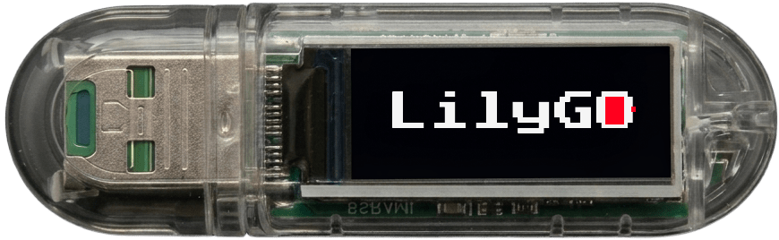
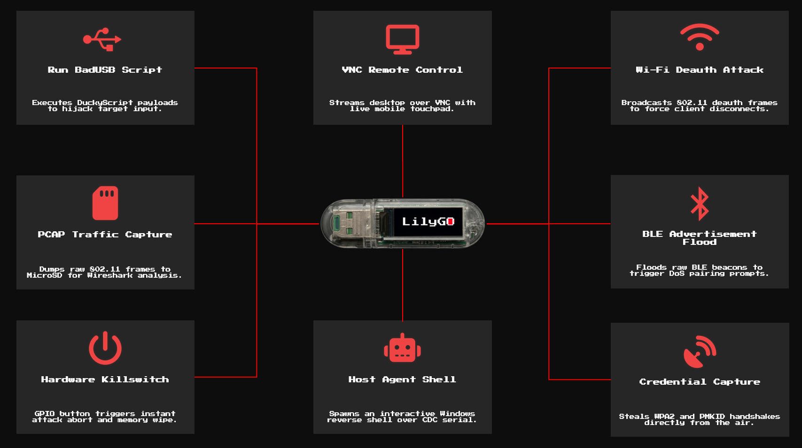

# RedLilyGO

[](https://github.com/zis3c/RedLilyGO/actions/workflows/main.yml)
[](https://github.com/zis3c/RedLilyGO/actions/workflows/dotnet.yml)
[](https://github.com/zis3c/RedLilyGO/actions/workflows/release.yml)
[](https://github.com/zis3c/RedLilyGO/releases)
[](./LICENSE)
[](https://platformio.org/)
[](https://www.espressif.com/en/products/socs/esp32-s3)
[](https://dotnet.microsoft.com/download/dotnet/8.0)
[](./docs/FIRMWARE_REFERENCE.md)
[](#security-posture)

**An ESP32-S3 firmware project for learning, experimentation, and authorized testing.**

RedLilyGO combines USB device modes, Wi-Fi and Bluetooth assessment workflows,
SD-backed files and captures, a local web console, and an optional Windows
Agent. The repository is intended for development and authorized lab use.

<p align="center">
  
</p>

> RedLilyGO is designed for authorized security testing, education, hardware
> development, and controlled demonstrations. Use it only on systems, devices,
> and networks where you have explicit permission.

## Product highlights

<p align="center">
  
</p>

| Area | Capability |
| --- | --- |
| USB | HID keyboard and mouse, mass storage, serial CDC, optional USB-NCM |
| Wireless | ESP32 Marauder WiFi and Bluetooth assessment workflows |
| Storage | SD_MMC capture, payload storage, file management, PCAP output |
| Console | Local WiFi dashboard with HTTP, WebSocket, and capability-aware UI |
| Automation | DuckyScript payload execution with hardware extensions |
| Host integration | Optional .NET 8 Windows Agent over USB CDC serial |
| Recovery | Crash streak tracking, safe mode, and USB recovery |
| Hardware | TFT display, physical button, status LED, and optional board modules |

The default LILYGO-T-Dongle-S3 profile enables TFT, SD_MMC, button, LED, WiFi,
and USB support. Marauder radio operations can temporarily interrupt the
RedLilyGO AP because the board has one WiFi radio.

## Security posture

> **Intended use:** RedLilyGO is a hardware security-testing tool. Use it only
> on systems and networks you own or are authorized to test. See
> [NOTICE.md](./NOTICE.md) for the full statement.

RedLilyGO serves its web interface over HTTP on the device network. It is not
designed to be exposed to the public Internet or an untrusted LAN.

- First-run setup checks the request origin and a one-time nonce, then enables
  HTTP Basic Authentication with the credentials you choose.
- Basic Authentication can later be disabled in settings. Browser mutation
  routes also reject requests marked as cross-site, but this is not a network
  isolation boundary. Some legacy command routes use query parameters.
- HTTP and WebSocket traffic are not protected by TLS in the default profile.
- The default Wi-Fi password in the current firmware is `redlilygo`. Change it
  before sharing the AP with other people.
- The optional Windows Agent communicates over USB CDC. Treat physical access
  to that interface as access to the attached host; USB identity values are not
  cryptographic authentication.
- Firmware updates use USB flashing. Payloads, PCAP files, logs, and host
  command output can contain sensitive data. Store and delete them according to
  your assessment policy.
- Do not use the project for unauthorized access, credential collection,
  persistence, stealth, surveillance, or disruption.

For responsible use, see the firmware reference and recovery guide.

## Supported hardware

| Board/profile | Status | Default capabilities |
| --- | --- | --- |
| LILYGO T-Dongle-S3 | Primary supported profile | TFT, SD_MMC, button, LED, WiFi, USB, Marauder |

Board-specific flags and pin assignments are defined in platformio.ini. See the
hardware reference before connecting optional modules.

## Quick start

### Option A: Flash Pre-built Release (Fastest)

If you just want to run RedLilyGO on your dongle without installing build tools, download the pre-compiled binaries from the latest [Release](https://github.com/zis3c/RedLilyGO/releases):

1. **Flash using `esptool`**:

   ```bash
   # Install esptool if needed
   pip install esptool

   # Flash all components (replace COM7 with your actual device port)
   esptool.py --chip esp32s3 -p COM7 write_flash 0x0000 bootloader.bin 0x8000 partitions.bin 0x10000 firmware.bin
   ```

2. **Web Browser Flasher (Chrome / Edge)**:
   Flash directly from your browser without terminal commands using [ESP Web Tools](https://esphome.github.io/esp-web-tools/) or [Adafruit WebSerial ESPTool](https://adafruit.github.io/Adafruit_WebSerial_ESPTool/) with offset mappings: `0x0000` (`bootloader.bin`), `0x8000` (`partitions.bin`), `0x10000` (`firmware.bin`).

---

### Option B: Build and Flash from Source

#### Prerequisites

- Python 3 with PlatformIO Core
- Node.js and npm for UI checks and browser tests
- .NET 8 SDK for the optional Agent
- USB data cable
- LILYGO T-Dongle-S3 or a supported profile

### Build and verify

Run from the repository root:

```powershell
.\tools\verify.ps1
```

Install the locked UI dependencies and Playwright Chromium first, following
[tests/README.md](./tests/README.md). This script regenerates UI assets, runs all
source contracts, syntax checks, host firmware/tool regressions and desktop/mobile
Playwright tests, builds and checks the Windows Agent, then builds the selected
firmware environment. Physical board tests are separate; record them in
[docs/HARDWARE_TEST_RESULTS.md](./docs/HARDWARE_TEST_RESULTS.md).

Or build the primary firmware environment directly:

```powershell
python -m platformio run -e LILYGO-T-Dongle-S3
```

### Flash

List connected PlatformIO devices first:

```powershell
python -m platformio device list
```

Automatic port selection:

```powershell
.\tools\flash.ps1
```

For a host with multiple serial devices, pass the board's current port:

```powershell
.\tools\flash.ps1 -Port COM7
```

Replace `COM7` with the port shown on your computer. The flash script's
automatic selection is not a substitute for checking the selected device.
Upload success verifies image writing only. Record boot and peripheral checks
in the hardware test record.

The `LILYGO-T-Dongle-S3` environment is configured for 8 MB flash and
`partitions_redlilygo_8mb.csv`. That table merges the two 3.3 MB OTA slots in
`default_8MB.csv` into one 6 MB factory app, because firmware updates are
USB-flashing only. The current build uses roughly 44% of the app partition,
leaving headroom for future features. Check the flash size on your board before
using this profile; do not select a partition table larger than the installed
flash.

USB may re-enumerate between the ROM bootloader and firmware. The bootloader
USB ID is `303A:1001`; the default application ID is `CAFE:403F`. Port names
vary by host and can change after reset, so list devices again before serial
operations. See [hardware details](./docs/HARDWARE.md) for the software thermal
guard and its limits.

#### BOOT / bootloader mode

The TFT can stay blank in ESP32-S3 ROM bootloader mode. This is expected: the
ROM bootloader only handles USB download and does not initialize the TFT.

To enter download mode manually:

1. Disconnect the board.
2. Hold the `BOOT` button.
3. Connect the board to USB.
4. Release `BOOT` after the USB device appears.
5. Check the new COM port with `python -m platformio device list`.

A blank TFT does not mean bootloader entry failed. Confirm the COM port and
let PlatformIO or esptool verify the connection. The TFT logo appears only
after the flashed firmware exits bootloader mode and boots normally.

### First web connection

1. Power the board and join the RedLilyGO WiFi network.
2. Open <http://4.3.2.1/> (the default AP address; change `wifi-ap-ip` to use a different subnet).
3. The current default AP password is `redlilygo`; use it only for first setup.
4. Complete first-run setup with a username of 3 to 32 characters and a
   password of 12 to 64 characters. This enables web Basic Authentication.
5. Change the AP password in Wi-Fi settings, then reconnect with the new value.
6. Review dashboard capability state before using a feature.

### Live dashboard data

The Dashboard refreshes device data from `/data.json`. SD storage, heap usage,
temperature, error count, and Agent fields update automatically. Files and
Captures refresh while their tab is active.

Dashboard values are firmware-backed. The payload selector lists `.ds` files
reported by the SD card, and unavailable hardware is shown as unavailable
instead of being replaced with sample values.

The Marauder page starts WiFi packet capture with `WiFi packet capture (PCAP)`
and stops it with `Stop active scan/attack`. Files manages the saved PCAP and
log files. USB-NCM capture remains available through the backend and Ducky
commands, but has no dedicated capture page control.

Raw Input and payload injection report queued or failed status inline without
redirecting the page. Uploads refresh the file browser and payload selectors.
Native USB HID does not require the Agent.

### Optional Windows Agent

The Agent provides authorized host integration over USB serial:

```powershell
.\tools\publish-agent.ps1
.\tools\start-agent.ps1
```

Use the Agent only on a host you own or administer. Remote display, HID, and
command execution are unavailable when the required capability is absent.

## Typical workflows

### USB HID control

Set USB mode to `Serial + HID`, connect the board to an authorized test host,
and use the web input-only page at `/remote/input`. This controls native board
HID without requiring the Windows Agent.

### DuckyScript

Store a .ds payload on the SD card and run it from the dashboard or payload
selector. autorun.ds runs at boot when autorun is enabled. Review the payload
before execution and test it in an isolated environment.

DuckyScript payloads live under [`payloads/`](./payloads/), grouped by topic
with a guide per folder. Some are HID-only; others use firmware hardware
extensions. Read the folder guide before running a payload.

### WiFi assessment and PCAP

Use Marauder scan and capture features only against approved targets. Stop the
capture, close the file, and safely eject the SD card before analysis. PCAP
files may contain private traffic.

`Rickroll` keeps the dashboard AP on its current channel, so the web UI can
usually remain available while it runs. Random beacon spam hops channels and
can disconnect the dashboard client. Use **Stop active scan/attack** in the
Marauder dropdown, or press BOOT three times if the client is disconnected.

### EvilAP lab demonstration

The [EvilAP payload guide](./payloads/evilap/README.md) uses
`redlilygo-demo.html`, a synthetic local demo page. Use it only in an isolated,
authorized lab with test data. It is not a production login page.

The Files page lists form HTML files from `/Portal`. Select one with `Use as
Portal Template`, then run `Start Evil Portal` from the Marauder command
dropdown. Stop it with `Stop active scan/attack` or BOOT triple-click. Files
such as `/Portal/index.html` and `/Portal/company-test.html` can exist together.
Test submissions are stored locally in `/Captures/Portal/evilportal_submissions.jsonl`.
Use synthetic credentials only.

New SD files use these friendly folders: `/Portal` for HTML, `/Scripts` for
DuckyScript, `/Captures` for PCAP/log/CSV output, `/Images` for images, and
`/Other` for other uploads. Files already in the root stay there and remain
usable as legacy files. Files upload with `Auto` by default, or a folder can be
chosen explicitly from `Save to`.

System log entries are queued and appended to `/Logs/system.log` by the
firmware loop. Each successful append is flushed and closed, but storage
failures can delay writes and the pending queue is bounded. The Logs page can
load the latest 200 saved lines. Runtime log clearing does not delete the SD
log. There is no automatic rotation; a full card can stop new log writes while
firmware continues running.

### USB-NCM capture

Set `usbDeviceType` to NCM, reconnect USB, run the approved capture flow, and
check `/Captures/Other/usbncm_0.pcap` after capture stops.

### Feature tutorials & video walkthroughs

Step-by-step hands-on tutorials walking through AP connection, web configuration,
native USB HID control, DuckyScript payloads, Marauder beacon spam, and EvilAP
workflows are documented in [docs/VIDEO_OVERVIEW.md](./docs/VIDEO_OVERVIEW.md).

Manual client compatibility was verified across four testing devices:
Huawei MateBook D14 (host PC), Samsung Galaxy A30, iPhone XS, and Samsung Galaxy Tab A8.

## Project layout

```text
RedLilyGO/
├── .github/              CI workflows and issue templates
├── data/                 Device-side payloads and assets
├── docs/                 Product, firmware, hardware, and release docs
├── lib/                  Bundled libraries (ESP32 Marauder, USB-NCM)
├── payloads/             DuckyScript payloads, grouped with guides
├── scripts/              PlatformIO build hooks
├── src/                  ESP32 firmware source
├── tests/                Host contracts, regressions, and device smoke assets
├── tools/                Build, flash, release, and Agent tooling
├── ui/                   Web UI source and VNC assets
├── build_ui.py           Generates the web UI under ui/content/
├── platformio_assets.py  Embeds UI assets as headers under src/html/
├── preview_server.py     Local UI preview and proxy
├── platformio.ini        Board and build configuration
├── partitions_redlilygo_8mb.csv  Partition table
├── openapi.yaml          HTTP API contract
├── asyncapi.yaml         WebSocket and event contract
├── README.md             Project entry point
├── CONTRIBUTING.md       Contribution guide
├── SECURITY.md           Security policy
├── NOTICE.md             Intended-use and legal notice
├── CODE_OF_CONDUCT.md    Contributor code of conduct
├── CHANGELOG.md          Release notes
├── THIRD_PARTY_NOTICES.md  Third-party licenses and notices
├── .gitleaks.toml        Secret-scanning configuration
├── LICENSE
└── VERSION
```

Generated files under src/html/ are build outputs and must not be edited
manually.

Web UI source lives under `ui/src/`, split by feature for maintenance. Run
`python build_ui.py` after editing it; this generates firmware-facing files in
`ui/content/`. The PlatformIO pre-build hook `platformio_assets.py` compresses
those assets into headers under `src/html/`. Edit the source files, not either
generated tree.

## Documentation

- [Architecture](./docs/ARCHITECTURE.md)
- [Firmware reference](./docs/FIRMWARE_REFERENCE.md)
- [Setup](./docs/SETUP.md)
- [Hardware reference](./docs/HARDWARE.md)
- [Recovery](./docs/RECOVERY.md)
- [Hardware test results](./docs/HARDWARE_TEST_RESULTS.md)
- [Hardware soak evidence](./docs/HARDWARE_SOAK_EVIDENCE.md)
- [Independent penetration test plan](./docs/PENTEST_PLAN.md)
- [TLS / reverse-proxy deployment](./docs/TLS_DEPLOYMENT.md)
- [HTTP API contract](./openapi.yaml)
- [WebSocket and event contract](./asyncapi.yaml)
- [Release checklist](./docs/RELEASE_CHECKLIST.md)
- [Contributing](./CONTRIBUTING.md)
- [Code of conduct](./CODE_OF_CONDUCT.md)
- [Changelog](./CHANGELOG.md)
- [Third-party notices](./THIRD_PARTY_NOTICES.md)
- [Security reporting policy](./SECURITY.md)
- [Intended-use notice](./NOTICE.md)
- [Security review](./docs/SECURITY_AUDIT.md)
- [Windows Agent guide](./tools/Agent/README.md)
- [Feature tutorials & video walkthroughs](./docs/VIDEO_OVERVIEW.md)

## Verification

The local release gate runs firmware, UI, security, WebSocket, and Agent checks:

```powershell
.\tools\verify.ps1
```

Hardware-only claims require a completed hardware test record. CI success alone
does not prove boot, radio behavior, USB enumeration, storage reliability, or
long-duration stability.

## Project status

The primary target is the `LILYGO-T-Dongle-S3` environment. The current
firmware version is in `VERSION`; release notes are in `CHANGELOG.md`. The
project is under active development and should be validated against the exact
board, firmware build, and Agent version being deployed.

## License

RedLilyGO is released under the MIT License. See LICENSE for details.
Original RedLilyGO additions are attributed to `zis3c` and contributors.
Third-party dependencies retain their respective licenses. See
[THIRD_PARTY_NOTICES.md](./THIRD_PARTY_NOTICES.md).

## Acknowledgements

RedLilyGO is based on [USBArmyKnife](https://github.com/i-am-shodan/USBArmyKnife)
and includes [ESP32 Marauder](https://github.com/justcallmekoko/ESP32Marauder),
along with other open-source dependencies. Copyright notices and license links
are listed in [THIRD_PARTY_NOTICES.md](./THIRD_PARTY_NOTICES.md).
